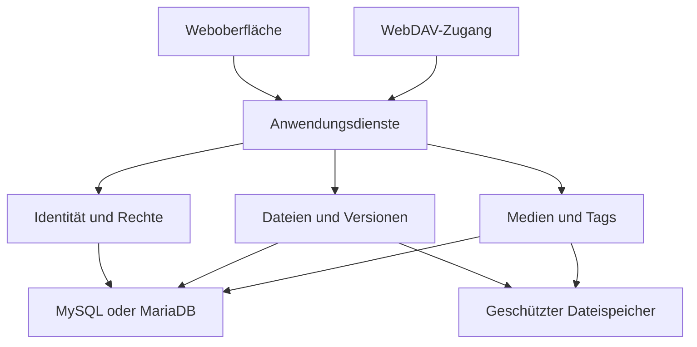

# Konzept: PHP-basierte Datei- und Medienplattform

Version: 1.3
Stand: 21. Oktober 2026
Status: Konzept zur Abstimmung, keine Implementierungsfreigabe zusätzlicher Komponenten

## 1. Ziel und Leitlinien

Entwickelt werden soll eine schlanke, selbst betriebene Open-Source-Plattform für Dateien und Medien. Sie verbindet eine moderne Weboberfläche mit WebDAV, OIDC-Anmeldung, einer vollständigen lokalen Zugangsverwaltung und gruppenbasierten Berechtigungen. Eine Medienbibliothek stellt Grafiken und Bilder übersichtlich dar. Viewer, Texteditor, Tags und Versionierung ergänzen die Dateiverwaltung.

Das System soll auf einem üblichen PHP-Hosting betrieben werden können. Zusätzliche Technologien und Komponenten werden vor ihrem Einsatz abgestimmt. Zuverlässige Dateioperationen und nachvollziehbare Rechte haben Vorrang vor einem großen Funktionsumfang.

Automatisierte Tests sind ein verbindlicher Bestandteil der Entwicklung und der Abnahme jeder Ausbaustufe.

Alle fachlichen Funktionen erhalten dokumentierte Einhängepunkte für Erweiterungen. Zusätzliche Funktionen und unterstützte Anpassungen müssen als eigenständige Plugins möglich sein, ohne den Bestandscode des Kerns zu ändern. Diese Erweiterbarkeit wird von Beginn an entwickelt und getestet.

## 2. Verbindliche Grundlagen und Planungsannahmen

### 2.1 Bestätigte Anforderungen

| Bereich | Festlegung |
|---|---|
| Backend | PHP, verfügbar sind PHP 8.4 und 8.5 |
| Kompatibilität | Vorgeschlagenes Ziel: Mindestversion 8.4, Prüfung zusätzlich unter 8.5 |
| Datenbank | MySQL oder MariaDB vorhanden |
| Abhängigkeiten | Composer freigegeben |
| Browser | JavaScript freigegeben |
| Bildverarbeitung | GD verfügbar |
| Tests | PHPUnit freigegeben, automatisierte Testabdeckung erforderlich |
| Identität | Eigener OIDC-Provider der Mitgliederverwaltung |
| Externe Gruppen | Übergabe über den Claim `groups` |
| Mapping | Frei konfigurierbar, einschließlich 1:n und mehrerer Quellen für ein Ziel |
| RBAC | Rollen bündeln Berechtigungen; interne Gruppen erhalten Rollen im passenden Geltungsbereich |
| Nutzung der Erweiterungspunkte | RBAC wird von Beginn an als mitgeliefertes Pflichtplugin über öffentliche Schnittstellen umgesetzt |
| Zugriff | Weboberfläche und Einbindung als Speicher unter Windows, macOS und Smartphones |
| Medien | Gängige Bild- und Grafikformate, visueller Medienkatalog, eingebettete Metadaten und vorhandene KI-Kennzeichnungen auslesen |
| Ergänzende Funktionen | Medienrechte, erweiterbare Metadatenfelder, Sammlungen, Export und Dateireferenzen |
| Erweiterbarkeit | Dokumentierte Einhängepunkte in allen fachlichen Funktionen, Plugins ohne Änderungen am Kern |
| Lizenzmodell | Open Source; konkrete Projektlizenz noch festzulegen |

### 2.2 Annahmen für dieses Konzept

- Betrieb einer einzelnen Installation für eine Organisation, ohne Mandantenfähigkeit.
- Dateien liegen auf einem lokalen Server-Dateisystem außerhalb des öffentlich erreichbaren Webverzeichnisses.
- MySQL oder MariaDB enthält Benutzer, Gruppen, Berechtigungen, Dateimetadaten und Verwaltungsdaten.
- Dateiinhalte werden nicht als Datenbank-BLOBs gespeichert.
- Dateimanipulationen erfolgen ausschließlich über die Anwendung oder WebDAV. Direkte Änderungen im Speicherverzeichnis sind zunächst nicht unterstützt.
- HTTPS wird durch die bestehende Serverumgebung bereitgestellt.
- Eine gemeinsame Datenbank ist möglich; für Tests wird zwingend eine separate Testdatenbank verwendet.

Diese Annahmen sind Architekturvorschläge. Abweichungen müssen vor der Implementierung berücksichtigt werden.

## 3. Funktionsumfang

### 3.1 Dateien und Speicherbereiche

Persönliche und gemeinsame Speicherbereiche erhalten eigene Quoten und Berechtigungen. Die Oberfläche unterstützt Ordner, Upload, Download, Umbenennen, Kopieren, Verschieben, Mehrfachauswahl und Papierkorb.

Dateien besitzen eine stabile interne ID. Umbenennen und Verschieben verändern diese ID nicht. Kopieren erzeugt eine neue ID; welche Metadaten dabei übernommen werden, wird explizit festgelegt. Vorschlag: Tags und Beschreibung werden kopiert, Versionshistorie und Audit-Einträge nicht.

Versionierung ist spätestens vor der Freigabe des Editors erforderlich. Sie gilt dann einheitlich für Änderungen über die Weboberfläche und WebDAV. Aufbewahrung, Quotenberechnung und endgültige Löschung sind konfigurierbare Betriebsregeln.

### 3.2 Medienbibliothek

Die Medienbibliothek ist eine alternative Ansicht des vorhandenen Dateibestands und erzeugt keine unabhängige Kopie der Dateien.

- Responsives Raster mit veränderbarer Vorschaugröße.
- Umschaltung zwischen Raster und Dateiliste.
- Große Bildansicht mit Zoom und Navigation.
- Technische Angaben zu Format, Abmessungen und Dateigröße.
- Beschreibung, Tags und Mehrfachbearbeitung von Tags.
- Filter nach Speicherbereich, Dateityp und Tags.
- Suche nach Dateiname, Beschreibung und Tags.

Für die erste Ausbaustufe werden JPEG, PNG, WebP und GIF vorgesehen. Die Installationsprüfung ermittelt die tatsächliche GD-Unterstützung. AVIF ist optional bei vorhandenem Codec. SVG wird separat behandelt und nicht durch GD gerastert. Animierte Dateien können als Original dargestellt werden; eine Vorschau darf statisch sein und darf das Original nicht verändern.

SVG und andere aktive Inhalte dürfen nicht ungeprüft inline in die Anwendungsseite eingebettet werden. Eine geeignete isolierte Darstellung beziehungsweise Bereinigung wird vor Umsetzung festgelegt. Ist keine sichere Vorschau möglich, bleibt der Download verfügbar.

HEIC, TIFF, RAW und PSD gehören zunächst nicht zur zugesagten Vorschaufunktion. Speicherung und Download bleiben unabhängig davon möglich. Eingebettete Metadaten wie EXIF, IPTC und XMP sowie vorhandene KI-Kennzeichnungen werden gemäß Abschnitt 3.4 ausgelesen. Konkrete Formatabdeckung und erforderliche Erweiterungen werden vor der Umsetzung geprüft; sensible Angaben wie GPS erhalten gesonderte Zugriffs- und Exportregeln.

### 3.3 Viewer und Editor

| Inhalt | Erste Umsetzung |
|---|---|
| Bilder | Geschützte Bildansicht, Zoom und Navigation |
| PDF | Einbindung des Browser-PDF-Viewers, Download als Rückfalloption |
| Text | Sicher maskierte Textansicht mit Größenlimit |
| Markdown | Zunächst Textansicht; gerenderte Vorschau nach Bibliotheksauswahl |
| Audio und Video | Wiedergabe nur bei Browser- und Codec-Unterstützung |
| Office-Dateien | Speicherung und Download; keine zugesagte Browser-Bearbeitung |

Der einfache Editor unterstützt Text, Markdown, JSON, YAML und vergleichbare Textdateien. Er speichert mit einer Versionsbedingung. Wurde die Datei seit dem Öffnen verändert, darf kein stilles Überschreiben erfolgen. Stattdessen zeigt die Oberfläche einen Konflikt und ermöglicht das Sichern der eigenen Änderungen.

Syntaxhervorhebung, Markdown-Rendering und Office-Integration sind zusätzliche Komponenten und benötigen vor ihrem Einsatz eine Abstimmung.

### 3.4 Eingebettete Metadaten und KI-Kennzeichnungen

Vorhandene Dateimetadaten werden automatisch ausgelesen, soweit Dateiformat und freigegebener Extraktor dies ermöglichen. Die Verarbeitung gilt für Uploads über Browser und WebDAV, neue Inhaltsversionen und einen nachträglichen Import vorhandener Bestände. Ein manueller Neuaufbau der Metadaten ist möglich, ohne Originaldateien zu verändern.

| Quelle | Zu berücksichtigende Informationen |
|---|---|
| Technische Dateidaten | Erkanntes Format, Abmessungen, Farbinformationen und bei unterstützten Formaten Dauer |
| EXIF | Aufnahmezeit, Orientierung, Kamera und weitere verfügbare Aufnahmedaten |
| IPTC und XMP | Titel, Beschreibung, Schlagwörter, Urheber, Bildnachweis, Rechte und digitale Herkunft |
| Formatspezifische Felder | Beispielsweise PNG-Textfelder und dokumentierte Generatorangaben |
| KI-bezogene Felder | Deklaration KI-generierter oder mit KI bearbeiteter Inhalte, benanntes System und Modellversion sowie vorhandene Promptangaben |
| C2PA / Content Credentials | Vorhandene Herkunftsmanifeste und gegebenenfalls Ergebnisse einer separat unterstützten Validierung |

Der eingebaute Extraktionsdienst ist eine Pipeline aus registrierten Provider-Plugins. Die Basisfunktionen nutzen ebenfalls diese Schnittstellen. Neue Formate, Metadatenfelder und KI-Kennzeichnungen lassen sich durch weitere Provider ergänzen, ohne die Kernlogik anzupassen. Eine Formatmatrix benennt vor der Abnahme für jede Quelle die Zustände unterstützt, teilweise unterstützt oder nicht unterstützt.

GD liefert keine vollständige Metadaten- oder Herkunftsprüfung. Die Verfügbarkeit der PHP-Erweiterung EXIF sowie benötigter IPTC-, XMP- und Formatschnittstellen wird geprüft. ExifTool, C2PA-Werkzeuge, zusätzliche PHP-Bibliotheken, Erweiterungen oder externe Dienste werden ausschließlich nach gesonderter Abstimmung eingesetzt. C2PA-Unterstützung ist ein Ziel mit offener Komponentenentscheidung und wird ohne geeigneten freigegebenen Validator nicht als fertig geprüft dargestellt.

#### Herkunft, Normalisierung und Bearbeitung

Jeder ausgelesene Wert enthält Quelle beziehungsweise Feldpfad, Dateiversion, Extraktor mit Version, Zeitpunkt und Auslesestatus. Unterstützte Originalwerte und normalisierte Werte werden getrennt gespeichert. Vollständige Binärdaten oder beliebig große Metadatenblöcke werden nicht ungeprüft in die Datenbank kopiert.

Ausgelesene Angaben, manuelle Ergänzungen und redaktionelle Entscheidungen bleiben unterscheidbar. Vorhandene manuelle Beschreibungen oder Tags werden bei erneuter Extraktion nicht still überschrieben. Eingebettete Schlagwörter können als nachvollziehbare Tag-Vorschläge importiert werden. Konflikte zwischen Quellen werden angezeigt und durch dokumentierte, konfigurierbare Prioritätsregeln aufgelöst, ohne die Herkunft der Werte zu verlieren.

Die Bearbeitung von Katalogdaten schreibt zunächst nicht in die Originaldatei zurück. Eine spätere Funktion zum Einbetten geänderter Metadaten erzeugt einen neuen Dateistand und benötigt einen eigenen Provider sowie Tests für mögliche Auswirkungen auf Herkunftsnachweise.

#### KI-Status und Nachweisqualität

KI-Kennzeichnungen werden aus vorhandenen strukturierten Angaben ausgelesen. Beispielsweise unterscheidet IPTC Digital Source Type zwischen als generativ erstellt und als generativ bearbeitet gekennzeichneten Medien. Unspezifische Angaben zu synthetischen oder algorithmischen Medien werden nicht automatisch mit generativer KI gleichgesetzt.

Der Katalog trennt drei Dimensionen:

| Dimension | Beispielwerte |
|---|---|
| Deklarierte Entstehung | Als KI-generiert gekennzeichnet, als mit KI bearbeitet gekennzeichnet, andere deklarierte Herkunft, widersprüchliche Angaben, unbekannt |
| Verfügbarkeit und Auslesen | Ausgelesen, keine Kennzeichnung in den untersuchten Feldern, noch nicht untersucht, teilweise unterstützt, Format nicht unterstützt, Auslesefehler |
| Herkunftsnachweis | Nicht vorhanden, vorhanden und ungeprüft, Validierung fehlgeschlagen, Integrität bestätigt bei ungeklärtem Vertrauen, nach konfigurierter Vertrauensrichtlinie validiert |

Die Anzeige benennt die tatsächlich untersuchten Quellen. Fehlende Kennzeichnungen bedeuten nicht, dass eine Datei ohne KI entstanden ist. Ein Dateiname, der Name eines Bearbeitungsprogramms oder ein unspezifisches Freitextfeld genügt nicht für eine verlässliche KI-Einstufung. Ein allgemeiner KI-Bilddetektor und die Erkennung unsichtbarer Wasserzeichen sind nicht Teil dieser Funktion.

Das Vorhandensein eines C2PA-Manifests ist keine erfolgreiche Validierung. Die Prüfung muss den Bezug zum aktuellen Dateistand, kryptografische Integrität und die konfigurierte Vertrauensrichtlinie unterscheiden. Auch eine erfolgreiche Validierung ist kein Beweis für die sachliche Wahrheit eines Bildes. Externe Manifestabrufe, falls später unterstützt, benötigen eine gesonderte Netzwerk- und Vertrauensregel und erfolgen nicht ungeprüft anhand beliebiger Datei-URLs.

Metadaten sind nicht vertrauenswürdige Eingaben. Parser erhalten Größen-, Laufzeit- und Speichergrenzen; XMP/XML darf keine externen Entitäten oder beliebigen Netzabrufe auslösen. GPS, Gerätekennungen, Prompts und Namen von Promptautoren können sensible Angaben enthalten. Ihre Anzeige, Suche und ihr Export erhalten eigene RBAC-Berechtigungen. Vorschauen übernehmen solche Angaben nicht unkontrolliert. Originale und deren vorhandene Herkunftsdaten bleiben unverändert; Ableitungen werden nicht als unverändert signierte Originale ausgegeben.

### 3.5 Erweiterbare Felder und Medienrechte

Plugins registrieren zusätzliche Metadatenfelder mit Namensraum, Datentyp, Validierung, Anzeige, Suchbarkeit, Exportregel und erforderlichen Berechtigungen. Unterstützte erste Feldtypen sind Text, Zahl, Datum, Auswahl und Referenz. Beispiele sind Veranstaltung, Fotograf und Aufnahmejahr. Ausgelesene Felder werden über dieselbe Feldregistrierung dargestellt.

Ein mitgeliefertes Medienrechte-Plugin ergänzt Urheber, Bildnachweis, Lizenz, Herkunft der Nutzungserlaubnis, erlaubte Verwendung und gegebenenfalls Ablaufdatum. Ein redaktioneller Status kann Entwurf, freigegeben oder archiviert sein. RBAC-Zugriff und Nutzungsrecht sind unterschiedliche Sachverhalte. Hinterlegte Erlaubnisse und KI-Angaben ersetzen keine rechtliche Prüfung.

Der redaktionelle Status ist zunächst Kataloginformation. Verbindliche Download- oder Freigabesperren erfordern explizit konfigurierte, serverseitige Validierungspunkte; ein bloßes Statusetikett verändert keine Dateirechte. Manuelle Korrekturen von Medienrechten und KI-Angaben werden mit Akteur, Zeitpunkt und Begründung protokolliert und verdecken nicht die ausgelesenen Ausgangsdaten.

### 3.6 Sammlungen und Referenzen

Ein Sammlungs-Plugin stellt Dateien aus verschiedenen Ordnern thematisch zusammen, ohne Inhaltskopien anzulegen. Die ursprünglichen Dateirechte bleiben wirksam. Nicht zugängliche Einträge werden weder über Vorschaubilder noch über Titel, Trefferzahlen oder Metadaten offengelegt.

Eine öffentliche Referenzschnittstelle erlaubt Plugins, Beziehungen zu Dateien zu registrieren und über ihre eigenen Daten aufzulösen. Vor einer endgültigen Löschung zeigt die Anwendung zugängliche Verwendungen an. Pro Referenztyp ist festgelegt, ob Löschung blockiert wird, eine explizite Bestätigung erfordert oder die Referenz kontrolliert entfernt wird. Bei fehlendem Plugin und ungeklärter blockierender Referenz erfolgt keine stille endgültige Löschung. Dateireferenzen verwenden stabile Datei-IDs.

### 3.7 Portabilität und Export

Ein Export enthält Dateien unter verständlichen Namen und optional ein maschinenlesbares Metadatenmanifest mit Tags, Beschreibungen, Medienrechten, KI-Angaben samt Herkunft, Sammlungszuordnungen und Versionsinformationen. Plugins können eigene, versionierte Exportbeiträge registrieren. Die konkrete Paketierung, etwa ZIP und JSON, wird mit den benötigten PHP-Erweiterungen abgestimmt.

Der Export berücksichtigt aktuelle Dateirechte und gesonderte Rechte für sensible Metadaten. Er darf keine internen Secrets, Passwort-Hashes oder fremden Ressourcen enthalten. Große Exporte müssen begrenzt oder über abgestimmte Hintergrundaufgaben verarbeitet werden. Eine Datensicherung für die Wiederherstellung und ein portabler Benutzerexport sind unterschiedliche Funktionen. Ein vollständiger Reimport in ein beliebiges Fremdsystem wird nicht zugesagt.

### 3.8 Nutzungsszenarien und Abnahmebeispiele

| Szenario | Erwartetes Verhalten |
|---|---|
| Mitglied lädt Bilder hoch | Dateianlage nur im freigegebenen Bereich; Metadatenextraktion und Vorschauerzeugung über dieselben Provider wie bei WebDAV |
| Medienredaktion bearbeitet Bilder im Katalog | Beschreibungen und Tags ändern sich mit passender Rolle; Originaldatei und ausgelesene Herkunft bleiben erhalten |
| Datei enthält eine KI-Kennzeichnung | Deklarierter Status und Quelle erscheinen; eine bloß vorhandene Signatur wird nicht als validiert angezeigt |
| Datei enthält keine erkennbare KI-Kennzeichnung | Anzeige benennt den untersuchten Umfang; kein Etikett als sicher ohne KI erzeugt |
| Metadatenparser unterstützt das Format nicht | Download bleibt nach normalen Rechten möglich; Metadatenstatus benennt die Einschränkung |
| Neue Version wird über WebDAV geschrieben | Neue Extraktion wird dem neuen Stand zugeordnet; alte Nachweise werden nicht ungeprüft übernommen |
| Mitglied öffnet eine Sammlung | Nur zugängliche Dateien und deren zugängliche Metadaten erscheinen |
| Verantwortlicher exportiert einen Bestand | Dateiinhalte und zulässige Metadaten sind zuordenbar; sensible Angaben folgen der Exportregel |
| Plugin ergänzt einen Extraktor | Installation und Registrierung funktionieren ohne Änderung an Kerncode und Kernvorlagen |

## 4. Architektur

### 4.1 Modularer Monolith

Eine gemeinsame PHP-Anwendung stellt Weboberfläche und WebDAV bereit. Fachliche Dienste sind von HTTP, Datenbank und Dateisystem getrennt. Dadurch lassen sich Regeln unabhängig testen und von beiden Zugangswegen wiederverwenden.

Zentrale Module:

| Modul | Verantwortung |
|---|---|
| Identity | OIDC, lokale Profile, Sitzungen, Sperren und App-Passwörter |
| Authorization | Unumgehbarer Prüfpfad, Ressourcen- und Aktionskontext, obligatorische Policy-Provider |
| RBAC-Plugin | Rollen, Berechtigungskatalog, Gruppenzuweisungen, Rechteauflösung und Verwaltungsoberfläche |
| Storage | Speicherbereiche, Ordner, Dateien, Uploads, Quoten und Papierkorb |
| Versioning | Unveränderliche Dateistände und Wiederherstellung |
| Media | Vorschaubilder, Metadatenpipeline, Felder, Tags und Suche |
| Mitgelieferte Medienplugins | Extraktoren, KI-Kennzeichnungen, Medienrechte, Sammlungen, Referenzen und Exportbeiträge |
| WebDAV | Protokolladapter auf dieselben Anwendungsdienste |
| Administration | Verwaltung, Betriebsstatus und Audit-Protokoll |

Keine Route greift ungeprüft direkt auf Dateiinhalte zu. Das gilt auch für Vorschauen, Versionsdownloads, Papierkorb und HTTP-Range-Anfragen.

### 4.2 Oberfläche

Vorgeschlagen sind serverseitig erzeugtes HTML, CSS und gezielt eingesetztes JavaScript ohne verpflichtenden Node.js-Buildprozess. Ein konkretes Frontend- oder PHP-Framework ist noch nicht freigegeben.

Die Oberfläche berücksichtigt responsive Navigation, Tastaturbedienung, sichtbaren Fokus, verständliche Beschriftungen, ausreichende Kontraste, Drag-and-drop als Ergänzung zur normalen Dateiauswahl sowie verständliche Lade-, Fehler- und Leerzustände. Ziel ist eine Orientierung an WCAG 2.2 AA; eine formelle Konformität wird erst nach entsprechender Prüfung zugesagt.

### 4.3 Dateispeicherung und Konsistenz

Der physische Speicher verwendet interne Kennungen und unveränderliche Inhaltsstände. Benutzerseitige Dateinamen und Ordner bilden einen logischen Baum in der Datenbank. Physische Pfade werden nicht aus ungeprüften Benutzereingaben zusammengesetzt.

Uploads werden gestreamt und zuerst temporär gespeichert. Größe, Zielrechte und verfügbare Quote werden vor der Freigabe geprüft. Inhaltsstände werden innerhalb desselben Dateisystems atomar bereitgestellt. Die Datenbank verweist erst nach erfolgreicher Bereitstellung auf den neuen Stand. Ein abgebrochener Vorgang darf eine bestehende Datei nicht beschädigen.

Dateisystem und Datenbank besitzen keine gemeinsame Transaktion. Deshalb braucht es definierte Zwischenzustände, wiederholbare Abschlussoperationen und eine Bereinigung verwaister temporärer Dateien beziehungsweise Inhaltsstände. Quoten und konkurrierende Schreibzugriffe benötigen Transaktionen oder geeignete Sperren.

Ein Konsistenzprüfer und eine Wiederherstellungsanleitung sind Teil der Betriebsfreigabe. Ein klassischer Verzeichnisbaum mit direkt lesbaren Originalnamen wäre eine alternative Speicherstrategie, müsste aber vor Implementierung gesondert entschieden werden.

### 4.4 Durchgängige Erweiterungsarchitektur

Erweiterbarkeit ist eine verbindliche Querschnittsanforderung für jedes Modul und jede fachliche Funktion. Gemeint sind öffentliche Anwendungsfälle, ihre Verarbeitungsschritte und Oberflächenbeiträge. Private Hilfsmethoden werden nicht automatisch Teil der öffentlichen Plugin-Schnittstelle. Für jeden Anwendungsfall dokumentiert ein Erweiterungskatalog seine Einhängepunkte, Datenverträge und Grenzen.

Plugins liegen in eigenen Composer-Paketen oder separaten Erweiterungsverzeichnissen. Sie registrieren ihre Beiträge über eine versionierte Plugin-API. Der Kern lädt ausschließlich explizit aktivierte Erweiterungen. Plugins dürfen nicht von internen Klassen, privaten Methoden oder der internen Tabellenstruktur des Kerns abhängig sein. Funktionsausbau erfolgt über öffentliche Verträge und freigegebene Dienste.

Für die erste Version werden folgende Mechanismen vorgesehen:

| Mechanismus | Zweck | Beispiel |
|---|---|---|
| Ereignisse | Auf einen abgeschlossenen Vorgang reagieren | Nach einem Upload zusätzliche Verarbeitung anstoßen |
| Validierungspunkte | Vor einer Änderung zusätzliche Bedingungen prüfen und gegebenenfalls ablehnen | Upload anhand einer Organisationsregel zurückweisen |
| Transformationspunkte | Explizit freigegebene Eingaben oder Ausgaben typisiert ergänzen | Zusätzliche Metadaten normalisieren |
| Provider-Schnittstellen | Weitere Implementierungen für unterstützte Aufgaben registrieren | Neuer Viewer, Vorschauerzeuger oder Metadatenextraktor |
| Dekoratoren | Einen freigegebenen Dienst um Verhalten ergänzen | Zusätzliche Prüfung vor einer Dateioperation |
| UI-Einhängepunkte | Oberfläche ergänzen, ohne Vorlagen oder DOM-Struktur des Kerns zu verändern | Detailbereich, Kontextaktion, Spalte oder Administrationsseite |

Ein abstrakter Ablauf für eine Änderung lautet: Identität und unveränderliche Kernbedingungen prüfen, den verpflichtenden RBAC-Provider auswerten, Erweiterungsvalidierung ausführen, veränderliche Vorbedingungen erneut prüfen, Änderung verbindlich speichern und anschließend Abschlussereignisse bereitstellen. Transformationen, die Ziel, Ressource oder Inhalt verändern, erzwingen eine erneute Validierung und Rechteprüfung. Lesende Funktionen verwenden passende Abfrage-, Provider- und Darstellungspunkte; sie benötigen keinen künstlichen Schreibablauf.

### 4.5 Einhängepunkte in allen Funktionsbereichen

| Bereich | Verbindlich vorzusehende Erweiterungspunkte |
|---|---|
| Anmeldung und Benutzer | Nach validierter OIDC-Identität, Profilanreicherung, zusätzliche Zulassungsprüfung, Benutzeranlage, Statusänderung, Sitzung und Widerruf |
| Gruppen und Rechte | Claim-Normalisierung nach Tokenprüfung, Mappingprüfung, obligatorischer Authorization-Provider für RBAC, Registrierung zusätzlicher Berechtigungen, zusätzliche Zugriffsbeschränkungen, protokollierte Gruppen- und Rollenänderungen |
| Speicherbereiche und Dateien | Anlage, Auflistung, Upload, Download, Umbenennen, Kopieren, Verschieben, Papierkorb, Wiederherstellung, endgültige Löschung und Quoten |
| Versionierung | Erzeugung, Auswahl, Aufbewahrung und Wiederherstellung von Versionsständen |
| Medien | Formaterkennung, Vorschauerzeuger, Metadatenextraktoren, Medienansichten und Darstellung zusätzlicher Felder |
| Viewer und Editor | Provider-Auswahl, unterstützte Formate, Öffnen, Speichervalidierung und Abschlussereignisse |
| Tags und Suche | Zusätzliche Metadatenfelder, Tag-Validierung, Suchfilter und Suchprovider |
| WebDAV | Dieselben fachlichen Hooks wie im Browser sowie freigegebene Protokoll-Erweiterungen |
| Oberfläche | Navigation, Werkzeugleisten, Dateiaktionen, Detailbereiche, Listenfelder und Einstellungsseiten |
| Administration und Betrieb | Konfigurationsseiten, Diagnoseprüfungen, Wartungsaufgaben, Audit-Ziele und Plugin-Lebenszyklus |

Die vollständigen Namen und Signaturen werden mit dem jeweiligen Modul festgeschrieben. Der Katalog unterscheidet ausdrücklich vorläufige und stabile Verträge. Eine neue fachliche Funktion gilt ohne passenden Erweiterungsvertrag nicht als vollständig umgesetzt.

### 4.6 Verträge, Reihenfolge und Transaktionen

Jeder Einhängepunkt definiert einen stabilen Namen, eine Vertragsversion, typisierte Eingaben und Ergebnisse, erlaubte Änderungen, Ausführungsphase, Fehlerverhalten und Angaben zur Transaktion. Kontexte enthalten nur notwendige Informationen wie Akteur, Ressourcenkennungen, Zugangsweg und Vorgangskennung. Passwörter, Tokens und interne Datenbankverbindungen werden nicht allgemein an Plugins weitergegeben.

Ereignisdaten sind unveränderlich. Transformationspunkte liefern neue, validierte Ergebnisse. Mehrere Listener laufen in dokumentierter Reihenfolge, etwa nach Priorität und bei Gleichstand nach Plugin-ID. Für mehrere passende Viewer oder Provider werden Priorität, Auswahl und Rückfallverhalten ausdrücklich geregelt. Rekursive Auslösung und Endlosschleifen werden verhindert beziehungsweise begrenzt.

Ein Vorab-Hook darf einen Vorgang vor dessen Änderung ablehnen, aber keine unkontrollierten externen Nebenwirkungen innerhalb der Kerntransaktion verursachen. Fehler eines verpflichtenden Validators verhindern die Änderung. Ein Fehler einer optionalen Nachverarbeitung macht eine bereits gespeicherte Datei nicht nachträglich ungeschehen und wird getrennt angezeigt und protokolliert.

Zuverlässig nachzuliefernde Abschlussereignisse werden gemeinsam mit der Metadatenänderung in einer Datenbank-Outbox gespeichert. Eine spätere Verarbeitung erfolgt über den abgestimmten Mechanismus für Hintergrundaufgaben. Eine mindestens einmalige Zustellung erfordert idempotente Handler anhand einer Ereigniskennung. Ohne freigegebene Hintergrundverarbeitung wird keine zuverlässige asynchrone Ausführung zugesagt.

Bereits mitgelieferter Anwendungsfall: Das RBAC-Pflichtplugin nutzt die öffentlichen Einhängepunkte für Rechteentscheidungen, Berechtigungsregistrierung, Verwaltungsseiten und Audit-Ereignisse. Es ist kein später nachzurüstendes Beispiel. Ein Referenzplugin ergänzt darüber hinaus beispielsweise einen Viewer für einen weiteren Dateityp, registriert einen Metadatenextraktor und fügt einen Bereich in der Dateidetailansicht hinzu. Installation und Aktivierung ändern nur Plugin-Paket, Registrierung, eigene Daten und Konfiguration. Kerncode und Kernvorlagen bleiben unverändert.

### 4.7 Plugin-Verwaltung und Kompatibilität

Ein Plugin-Manifest enthält ID, Version, unterstützte Plugin-API-Versionen, PHP-Anforderungen, Abhängigkeiten, registrierte Beiträge, Konfigurationsschema und benötigte Fähigkeiten. Die Administration zeigt installierte, aktive, inkompatible und fehlerhafte Erweiterungen an.

Installation, Aktivierung, Deaktivierung, Update und Deinstallation sind getrennte Vorgänge. Produktiver PHP-Code wird über einen kontrollierten Deployment- beziehungsweise Composer-Prozess installiert. Ein freier Upload und die Ausführung beliebiger PHP-Pakete aus der Weboberfläche sind für die erste Version nicht vorgesehen.

Plugins erhalten eigene Konfiguration, Namensräume und bei Bedarf eigene Tabellen mit versionierten Migrationen. Direkte Änderungen an Kerntabellen sind ausgeschlossen. Fachliche Änderungen erfolgen über öffentliche Anwendungsdienste. Deaktivierung löscht keine Plugin-Daten; endgültiges Entfernen ist ein gesonderter Vorgang. Abhängige Plugins und erforderliche Sicherheitsprüfungen müssen vor einer Deaktivierung berücksichtigt werden.

Die Plugin-API verwendet semantische Versionierung. Brechende Änderungen benötigen einen Hauptversionswechsel, eine dokumentierte Migration und nach Möglichkeit eine vorgelagerte Abkündigung. Inkompatible Plugins werden vor Aktivierung oder Update erkannt. Eine garantierte Erweiterbarkeit sämtlicher zukünftiger Sonderfälle ist nicht möglich; fehlt später ein Vertrag, wird dieser gezielt im Kern ergänzt und anschließend stabil angeboten. Vorhandene Einhängepunkte sollen Kernänderungen für die vorgesehenen Erweiterungen vermeiden.

### 4.8 Rechte, Vertrauen und Oberfläche

Plugins erhalten ausschließlich über die registrierten Dienste Zugriff auf Ressourcen. Eigene Routen, Suchergebnisse, Vorschauen und UI-Aktionen unterliegen derselben Kern-Autorisierung. Das RBAC-Pflichtplugin liefert als registrierter Authorization-Provider die positive Rollenentscheidung. Weitere Plugins können Berechtigungen registrieren und zusätzliche Beschränkungen verlangen, aber eine Ablehnung der zentralen Rechteprüfung nicht durch einen generischen Hook aufheben. OIDC-Signaturprüfung, lokale Sperren und der grundlegende Schutz von Speicherpfaden bleiben zwingend.

Diese Regeln sind Architekturverträge, keine technische Sandbox: Ein PHP-Plugin im selben Prozess läuft grundsätzlich mit den Rechten der Anwendung. Deshalb werden ausschließlich vertrauenswürdige, geprüfte Plugins installiert. Eine Isolation nicht vertrauenswürdiger Erweiterungen würde eine zusätzliche, separat abzustimmende Architektur erfordern.

UI-Beiträge werden über benannte Bereiche und dokumentierte JavaScript-Schnittstellen registriert. Änderungen durch DOM-Manipulation an internen Selektoren sind kein unterstützter Integrationsweg. Beiträge beachten Berechtigungen, Übersetzbarkeit, Tastaturbedienung und responsive Darstellung. Serverseitige Autorisierung bleibt auch dann erforderlich, wenn eine Aktion im Browser ausgeblendet wird.

### 4.9 Entwicklerhandbuch und Referenzplugins

Jede freigegebene Plugin-API wird durch ein Entwicklerhandbuch beschrieben: Einstieg, Paketstruktur, Manifest, Registrierung, typisierte Kontexte, Transaktionsgrenzen, Fehlerregeln, Migrationen, Deaktivierung, Upgrade und Vertragstests. Ein Hook-Katalog ist Bestandteil der versionierten Dokumentation. Referenzplugins demonstrieren einen Validator, einen Medienextraktor, ein Metadatenfeld, eine UI-Erweiterung und einen Exportbeitrag.

RBAC und die mitgelieferten Medienfunktionen verwenden diese öffentlichen Schnittstellen bereits selbst. Architekturelle Sonderzugänge nur für eigene Plugins sind ausgeschlossen. Neue Einhängepunkte werden mit Beispiel und Tests eingeführt.

### 4.10 RBAC als erstes produktives Plugin

Die Erweiterungsarchitektur wird bereits für die mitgelieferte Funktionalität genutzt. Rollenbasierte Zugriffskontrolle (RBAC) wird als eigenständiges, mitgeliefertes Pflichtplugin entwickelt. Es verwendet dieselben veröffentlichten Schnittstellen, die späteren Plugins zur Verfügung stehen. Für zusätzliche Rollen oder Berechtigungen sind keine Änderungen am Bestandscode erforderlich, soweit die betreffende Funktion bereits eine passende Aktion registriert und prüft.

Der Kern besitzt den obligatorischen Autorisierungsaufruf und die festen Sicherheitsbedingungen. Er kennt keine fest codierten Rollennamen und greift nicht direkt auf RBAC-Tabellen zu. Das Plugin besitzt Rollen, Rollenberechtigungen und Zuweisungen in eigenen Tabellen. Mitgliedschaften, Ressourcenkennungen und Änderungsereignisse bezieht es über öffentliche Dienste.

| Öffentlicher Vertrag, vorgeschlagener Name | Verwendung durch RBAC |
|---|---|
| `AuthorizationProvider` | Entscheidung für Akteur, Aktion und Ressource einschließlich Geltungsbereich |
| `PermissionRegistry` | Registrierung stabiler Berechtigungskennungen durch Kernmodule und Plugins |
| `AdminPageRegistry` | Seiten für Rollen, Zuweisungen und wirksame Rechte |
| `UiContributionRegistry` | Rollenanzeige, Verwaltungsaktionen und Hinweise auf fehlende Rechte |
| `AuditEventPublisher` | Protokollierung von Rollen- und Zuweisungsänderungen nach erfolgreicher Speicherung |
| `IdentityChangeSubscriber` | Reaktion auf Gruppenänderungen, lokale Sperren und Sitzungswiderruf |

Diese Namen sind Vertragsentwürfe, keine zusätzlich ausgewählten Bibliotheken. Der Authorization-Provider liefert `Permit`, `Deny` oder `NotApplicable` sowie einen internen Grundcode. Nur ein ausdrückliches `Permit` des verpflichtenden RBAC-Providers bei erfüllten Kernbedingungen und ohne zusätzliche Ablehnung erlaubt den Vorgang. Fehler, fehlender Provider, unbekannte Aktion und nicht anwendbare Entscheidung führen zur Ablehnung.

RBAC ist für den normalen Anwendungsbetrieb zwingend. Bei fehlendem oder inkompatiblem Plugin verweigern geschützte Endpunkte den Zugriff. Die Webverwaltung darf es nicht deaktivieren. Wartung, Update und Wiederherstellung eines Administratorzugangs benötigen einen gesonderten, dokumentierten Betriebsweg und dürfen keinen allgemeinen Zugriff ohne RBAC eröffnen.

Die Rechteabfrage verändert keine Rollen und löst keine rekursiven Rechteabfragen über denselben Vorgang aus. Das Plugin darf ausschließlich seine eigenen Verwaltungsdaten über private Repositories verwalten. Zugriffe auf Dateien und andere Kernressourcen erfolgen weiterhin über die geschützten öffentlichen Anwendungsdienste.

## 5. Identität und Benutzerverwaltung

### 5.1 OIDC

Die Anwendung verwendet den Authorization Code Flow mit PKCE, sofern der Provider dies unterstützt. Vor Umsetzung werden Discovery, Endpunkte, Signaturverfahren, Claims und Logout-Verhalten gegen den Custom Provider geprüft.

Benutzer werden stabil über die Kombination aus `issuer` und `sub` identifiziert. E-Mail-Adressen und Anzeigenamen sind veränderliche Profilinformationen und keine Identitätsschlüssel.

Tokenprüfung umfasst insbesondere Signatur, erlaubte Algorithmen, Aussteller, Empfänger, Gültigkeit, `state` und `nonce` sowie die korrekte Zuordnung zur begonnenen Anmeldung. Tokens und Secrets dürfen nicht in Anwendungsprotokollen erscheinen.

### 5.2 Lokale Verwaltung

Die Mitgliederverwaltung bleibt führend für zentrale Identitäten, Passwörter und MFA. Die Plattform bietet:

- Benutzerliste mit Suche, Status und letztem Login.
- Profil und Anzeige der OIDC-Zuordnung.
- Anzeige externer Gruppen, interner Gruppen, zugewiesener Rollen und effektiver Rechte einschließlich ihrer Herkunft.
- Lokale Sperre und Entsperrung.
- Widerruf einzelner oder aller Sitzungen und App-Passwörter.
- Verwaltung lokaler Gruppen und Gruppenmappings.
- Übertragung persönlicher Dateien beim Ausscheiden.
- Audit-Einträge zu sicherheitsrelevanten Verwaltungsänderungen.

Das Erstellen zentraler Identitäten, Einladen per E-Mail oder Ändern zentraler Mitgliederdaten setzt zusätzliche Funktionen der Mitgliederverwaltung voraus und gehört ohne deren Schnittstelle nicht zum zugesagten Umfang.

Ein dokumentiertes Verfahren zum erstmaligen Einrichten und Wiederherstellen eines Administrationszugangs wird vorgesehen. Die genaue Umsetzung wird vor Produktivbetrieb abgestimmt.

### 5.3 WebDAV und App-Passwörter

Übliche WebDAV-Clients übernehmen einen OIDC-Browser-Login nicht automatisch. Vorgesehen sind deshalb pro Gerät benennbare, separat widerrufbare App-Passwörter, die nach OIDC-Anmeldung erstellt werden.

App-Passwörter werden nur bei Erstellung angezeigt, ausschließlich als geeigneter Hash gespeichert und über HTTPS verwendet. Der lokale Benutzerstatus und die aktuell wirksamen Rechte werden bei Zugriffen durchgesetzt. Eine lokale Sperre oder ein Widerruf verhindert weitere Zugriffe nach erfolgreicher Übernahme der Änderung, abgesehen von bereits laufenden Übertragungen.

## 6. Gruppenmapping und Berechtigungen

### 6.1 Mapping

Der `groups`-Claim wird gegen ein vereinbartes Schema validiert. Vorgeschlagen ist ein Array aus Zeichenketten mit exaktem, groß-/kleinschreibungssensitivem Vergleich. Abweichende Claim-Strukturen werden ausdrücklich konfiguriert.

| Externe Gruppe, Beispiel | Interne Zielgruppen, Beispiel |
|---|---|
| `vorstand` | `Dokumente-Verwaltung`, `Medien-Redaktion` |
| `aktive` | `Dokumente-Lesen`, `Medien-Upload` |
| `oeffentlichkeitsarbeit` | `Medien-Redaktion` |

Unbekannte Gruppen vergeben keine Rechte. Automatische Mitgliedschaften werden aus allen aktuellen Zuordnungen berechnet. Entfällt eine externe Quelle, bleibt eine interne Mitgliedschaft erhalten, wenn eine andere aktuelle Quelle sie weiterhin vergibt. Manuelle Mitgliedschaften werden getrennt gespeichert und nachvollziehbar angezeigt.

Ein vollständig neuer Benutzer erhält ohne passende Freigabe keinen automatischen Zugriff auf gemeinsame Speicherbereiche. Die automatische Erstellung persönlicher Speicherbereiche ist eine offene Produktentscheidung.

### 6.2 RBAC: Rollen, Berechtigungen und Geltungsbereiche

Die direkte Vergabe einzelner Dateirechte an Gruppen wird durch ein Rollenmodell ersetzt. Die Zuordnung verläuft von externen Gruppen über interne Gruppen zu Rollen und schließlich zu atomaren Berechtigungen. Das bestehende 1:n-Gruppenmapping bleibt erhalten.

| Begriff | Bedeutung |
|---|---|
| Externe Gruppe | Vom OIDC-Provider bestätigte Mitgliedschaft |
| Interne Gruppe | Lokal definierte Gruppe aus Mapping oder manueller Zuweisung |
| Berechtigung | Stabile Aktionskennung wie `files.read` oder `media.tags.update` |
| Rolle | Benanntes Bündel atomarer Berechtigungen |
| Rollenzuweisung | Verbindung einer internen Gruppe mit einer Rolle und einem Geltungsbereich |
| Geltungsbereich | Gesamte Anwendung oder genau ein Speicherbereich |

Für die erste Version werden Rollen an interne Gruppen vergeben. Direkte individuelle Rollenzuweisungen und verschachtelte Rollen sind nicht vorgesehen. Persönliche Zugänge können bei Bedarf über eine ausdrücklich verwaltete interne Gruppe abgebildet werden. Systemrollen werden initial angelegt; eigene Rollen können über die Verwaltung erstellt, kopiert und angepasst werden.

Beispiel für ein mehrstufiges Mapping:

| Externe Gruppe | Interne Gruppe | Rolle | Geltungsbereich |
|---|---|---|---|
| `vorstand` | `Dokumente-Verwaltung` | Bereichsverwaltung | Speicherbereich Vorstand |
| `vorstand` | `Medien-Redaktion` | Medienredaktion | Speicherbereich Medien |
| `oeffentlichkeitsarbeit` | `Medien-Redaktion` | Medienredaktion | Speicherbereich Medien |
| `aktive` | `Dokumente-Lesen` | Lesen | Speicherbereich Allgemein |
| `aktive` | `Medien-Upload` | Beitragen | Speicherbereich Medien |

Mehrere passende Rollen ergänzen sich innerhalb des angefragten Geltungsbereichs. Eine globale administrative Zuweisung gilt nur für die darin enthaltenen globalen Aktionen. Sie verleiht keine impliziten Datei- oder Medienrechte auf allen Speicherbereichen. Rollen und Berechtigungen deklarieren ihre zulässigen Geltungsbereiche; unzulässige Kombinationen werden bereits bei der Zuweisung abgelehnt.

Vorgeschlagene Startrollen:

| Rolle | Typische Berechtigungen |
|---|---|
| Lesen | Dateien auflisten, Vorschau, Download und Versionsstände ansehen |
| Beitragen | Lesen sowie neue Dateien und Ordner anlegen |
| Bearbeiten | Beitragen sowie Inhalte und Namen ändern, kopieren und Tags bearbeiten |
| Medienredaktion | Lesen, Hochladen, Medienbeschreibungen, Tags und Inhalte bearbeiten |
| Bereichsverwaltung | Dateiverwaltung, Papierkorb und freigegebene Bereichseinstellungen; begrenzte Delegation innerhalb des eigenen Bereichs |
| Benutzerverwaltung | Benutzerstatus, Gruppen und Gerätezugänge verwalten, ohne automatische Inhaltsrechte |
| Rollenverwaltung | Globale Rollen und Rollenzuweisungen gemäß explizitem Delegationsrecht verwalten |
| Systemverwaltung | Systemkonfiguration, Plugin-Verwaltung und Diagnose, ohne automatische Inhaltsrechte |

Diese Startrollen sind Vorschläge und werden vor der ersten Produktivverwendung geprüft. Eine Rolle erhält nur die ausdrücklich eingetragenen atomaren Berechtigungen. Technische Kennungen werden unabhängig von übersetzbaren Anzeigenamen gehalten. Es gibt keine pauschalen Sternrechte, die durch Installation eines Plugins automatisch neue Befugnisse verleihen.

Berechtigungen werden feiner modelliert als die folgenden fachlichen Sammelbegriffe. Beispiele sind `files.list`, `files.read`, `files.create`, `files.update`, `files.rename`, `files.copy`, `files.move`, `files.trash`, `files.restore`, `files.purge`, `versions.read`, `versions.restore`, `media.metadata.update`, `media.tags.update`, `users.manage`, `rbac.roles.manage` und `rbac.assignments.manage`. Die endgültige Liste entsteht mit dem jeweiligen Anwendungsfall. Zusammengesetzte Vorgänge prüfen alle erforderlichen Aktionen an Quelle und Ziel.

### 6.3 Fachliche Rechte auf Speicherbereiche

Für die erste Version gelten Dateirechte einheitlich auf Ebene ganzer Speicherbereiche. Explizite Verbotsregeln und individuelle Unterordner-Ausnahmen sind zunächst ausgeschlossen. Die folgenden Sammelbegriffe dienen der Erklärung; technisch erfolgt die Prüfung über die registrierten atomaren Berechtigungen aus den zugewiesenen Rollen.

| Recht | Inhalt |
|---|---|
| Lesen | Auflisten, Vorschau und Download |
| Hochladen | Neue Dateien und Ordner anlegen |
| Bearbeiten | Vorhandene Inhalte, Namen, Beschreibungen und Tags ändern |
| Löschen | Dateien und Ordner in den Papierkorb verschieben |
| Wiederherstellen | Inhalte aus dem Papierkorb zurückholen |
| Verwalten | Bereichseinstellungen und berechtigte Gruppen verwalten |

Versionen können mit Leserecht angesehen werden; das Wiederherstellen eines Versionsstands erfordert Bearbeitungsrecht. Endgültige Löschung bleibt zunächst der Bereichsverwaltung vorbehalten. Metadatenansicht setzt Leserecht voraus.

Kopieren prüft das Leserecht an der Quelle und das Anlegerecht am Ziel. Verschieben prüft zusätzlich das Löschrecht an der Quelle. Überschreiben benötigt Bearbeitungsrecht am Ziel. Rekursive Operationen müssen den gesamten Umfang vor einer Änderung prüfen oder nachvollziehbare Teilergebnisse liefern. Für die erste Version werden Änderungen innerhalb eines Speicherbereichs bevorzugt; bereichsübergreifende Operationen benötigen eine ausdrücklich getestete Regelung.

Systemadministration und Bereichsverwaltung sind getrennte Rollen. Ein Systemadministrator erhält nicht automatisch unbemerkten Zugriff auf alle persönlichen Dateien. Ein gegebenenfalls erforderlicher administrativer Inhaltszugriff muss explizit und protokolliert erfolgen.

### 6.4 Rollenverwaltung und Schutz vor Rechteausweitung

Die Administration bietet Rollenlisten, Bearbeitung des Berechtigungsumfangs, Zuweisung an Gruppen pro Speicherbereich und eine Erklärung effektiver Rechte. Die Erklärung nennt externe Quelle, interne Gruppe, Rolle, Aktion und Geltungsbereich. Geheimnisse und Inhalte anderer Bereiche werden dabei nicht offengelegt.

Das Recht zur Verwaltung eines Speicherbereichs erlaubt keine beliebige globale Rollenvergabe. Delegation ist auf explizit freigegebene Rollen und Geltungsbereiche begrenzt. Jede Zuweisung wird gegen die Delegationsbefugnis des handelnden Benutzers geprüft. Das Bearbeiten einer Rollendefinition ist von der Zuweisung einer vorhandenen Rolle getrennt. Bereichsverwalter dürfen gemeinsam verwendete globale Rollendefinitionen nicht ändern.

Die wirksame Befugnis zur Gruppenmitgliedschaftsverwaltung muss berücksichtigt werden: Wer Mitglieder in eine privilegierte Gruppe aufnehmen kann, kann deren Rollen mittelbar vergeben. Entsprechend gelten Delegationsprüfungen auch für manuelle Gruppenänderungen und OIDC-Mappingänderungen. Eigene Rechteausweitung über diese Wege ist ohne ausdrückliche administrative Befugnis unzulässig.

Neue Plugin-Berechtigungen werden registriert, aber keiner bestehenden Rolle automatisch hinzugefügt. Unbekannte oder deaktivierten Plugins zugeordnete Berechtigungen erteilen keinen Zugriff. Änderungen an Rollen, Berechtigungen, Zuweisungen, Gruppen und Mappings invalidieren betroffene Rechte-Caches. Cache-Schlüssel berücksichtigen Benutzer, Aktionskennung, Ressource, Bereich und die maßgebliche Berechtigungsversion. Hintergrundaufgaben prüfen aktuelle Rechte erneut, soweit sie im Benutzerauftrag handeln.

Rollenänderungen und Zuweisungen werden protokolliert. Rollen mit bestehenden Zuweisungen werden nicht unbemerkt gelöscht; die Oberfläche zeigt die Auswirkungen und verlangt eine explizite Auflösung oder Neuzuordnung. Der letzte nutzbare Administrationszugang wird gegen versehentlichen Entzug geschützt, einschließlich mittelbarer Änderungen an Gruppen und Mappings.

### 6.5 Änderungen und Rechteentzug

Beim erfolgreichen OIDC-Login werden Gruppen aktualisiert. Mappingänderungen können anhand des zuletzt bestätigten Gruppenstands neu berechnet werden. Dieser Stand beweist keine zwischenzeitlich geänderte Mitgliedschaft beim IdP.

OIDC allein liefert keine allgemeine laufende Gruppensynchronisierung. Für zentrale Änderungen stehen folgende Optionen zur Abstimmung:

1. Eine maximale Gültigkeitsdauer des Gruppenstands mit erzwungener erneuter OIDC-Anmeldung. Nach Ablauf werden auch App-Zugänge bis zur Erneuerung gesperrt.
2. Regelmäßiger Abruf über eine geeignete Schnittstelle der Mitgliederverwaltung.
3. Signierte Änderungsbenachrichtigungen mit zusätzlichem Abgleich für verpasste Ereignisse.

Die zulässige Verzögerung beim zentralen Rechteentzug ist vor Produktivbetrieb verbindlich festzulegen. Lokale Sperren wirken unabhängig davon.

## 7. Logisches Datenmodell

| Entität | Wesentliche Inhalte |
|---|---|
| users | OIDC-Aussteller und Subject, Profil, Status, letzter Login, Gruppenstand |
| groups | Interne Gruppen und Beschreibung |
| external_groups | Externe Gruppenkennungen je Provider |
| group_mappings | Zuordnungen externer zu internen Gruppen |
| memberships | Automatische und manuelle Mitgliedschaften mit Herkunft |
| spaces | Persönliche oder gemeinsame Speicherbereiche, Eigentümer, Quote |
| permissions | Vom Kern und Plugins registrierte Aktionskennungen mit erlaubten Geltungsbereichen; Eigentum beim RBAC-Plugin |
| roles / role_permissions | Rollen und zugehörige atomare Berechtigungen; Eigentum beim RBAC-Plugin |
| role_assignments | Interne Gruppe, Rolle und globaler oder bereichsbezogener Geltungsbereich; Eigentum beim RBAC-Plugin |
| delegation_rules | Explizite Grenzen zulässiger Rollenvergabe; Eigentum beim RBAC-Plugin |
| nodes | Stabile Datei- und Ordnerkennungen, Elternbeziehung, Name, Papierkorbstatus |
| file_versions | Inhaltsreferenz, Größe, Prüfsumme, MIME-Typ, Versionsstand, Urheber |
| media_metadata | Normalisierte Werte je Dateiversion mit Quelle, Extraktor und Verarbeitungsstatus |
| metadata_field_definitions / metadata_values | Registrierte Felder, Typen, manuelle Ergänzungen und Provenienz |
| media_provenance | Deklarierte KI-Herkunft, untersuchte Quellen und getrennter Validierungsstatus je Dateiversion |
| media_rights | Urheber, Bildnachweis, Lizenz, Verwendungserlaubnis und redaktioneller Status |
| collections / collection_items | Sammlungen und Referenzen auf stabile Datei-IDs |
| resource_references | Von Plugins registrierte Verwendungen und Löschregeln |
| tags / node_tags | Bereichsbezogene Tags und Dateizuordnungen |
| previews | Ableitungen mit Bezug zum Inhaltsstand und Verarbeitungsstatus |
| sessions | Sitzungen, Ablauf und Widerruf |
| app_passwords | Gerätename, Hash, Ablauf, Widerruf und letzte Nutzung |
| dav_locks | WebDAV-Sperren mit Ablauf |
| audit_events | Akteur, Vorgang, Ziel, Zeitpunkt und Ergebnis |
| plugins / plugin_settings | Installations- und Aktivierungsstatus, API-Kompatibilität, eigene Konfiguration |
| plugin_migrations | Angewendete Schemaänderungen je Plugin |
| outbox_events / event_deliveries | Verbindlich erzeugte Abschlussereignisse und Bearbeitungsstand je Empfänger |

Eindeutigkeit wird unter anderem für `(issuer, sub)`, Mappingpaare und Namen innerhalb desselben Ordners erzwungen. Namensvergleich, Unicode-Normalisierung und Datenbank-Collation werden so festgelegt, dass Windows-, macOS- und Smartphone-Clients nicht widersprüchliche Namen erzeugen. Tag-Namen werden nur innerhalb zugänglicher Speicherbereiche vorgeschlagen, damit keine Informationen aus fremden Bereichen sichtbar werden.

## 8. Sicherheit und Betrieb

- Geschützter Speicher außerhalb des Document Root, keine Ausführung hochgeladener Dateien.
- Vorbereitete Datenbankabfragen, CSRF-Schutz, sichere Cookies und Ausgabemaskierung.
- Strikte Autorisierung für Originale, Vorschauen, Versionsstände und Metadaten.
- Schutz vor Pfadmanipulation, Symlink-Ausbruch, unsicheren Dateinamen und MIME-Verwechslungen.
- Upload-, Bildpixel-, Arbeitsspeicher- und Vorschaugrenzen gegen Ressourcenerschöpfung.
- Begrenzung fehlgeschlagener Anmeldungen und Gerätezugriffe.
- Protokolle ohne Secrets, Tokens oder unkontrolliert gespeicherte Dateiinhalte.
- Konfigurierbare Aufbewahrung für Papierkorb, Versionen und Audit-Daten.

Die Installationsprüfung prüft außerdem die Verfügbarkeit und API-Kompatibilität des obligatorischen RBAC-Plugins.

Die Installationsprüfung erfasst PHP-Unterversion, benötigte Erweiterungen, GD-Formate, Datenbankversion, Schreibrechte und Uploadlimits. PDO-Treiber, OIDC-abhängige Erweiterungen und gegebenenfalls PHP-CLI werden vor Implementierung konkret geprüft und abgestimmt.

Backups umfassen Datenbank, Dateiinhalte und erforderliche Konfiguration. Für einen konsistenten Stand werden Schreibzugriffe angehalten oder eine geeignete Snapshot-Strategie eingesetzt. Ein Restore-Test gehört zur Betriebsabnahme. Vorschauen sind regenerierbar. Verschlüsselung im Ruhezustand und Schadsoftwareprüfung sind mögliche Erweiterungen und bislang nicht zugesagt.

Hintergrundaufgaben können über eine Datenbank-Aufgabenliste und PHP-CLI per Cron umgesetzt werden. Das ist ein Vorschlag, keine freigegebene zusätzliche Betriebsanforderung. Ohne Cron braucht es eine abgestimmte Alternative für zuverlässige Bereinigung und Vorschauerzeugung.

### 8.1 Updates, Migrationen und Wiederherstellung

Vor einem Update werden PHP- und Datenbankkompatibilität sowie die Plugin-Abhängigkeiten geprüft. Zu jedem Release gehören Migrationshinweise, erforderliche Sicherungsschritte und ein Wiederherstellungsplan. Nicht kompatible Pflichtplugins verhindern das Update beziehungsweise den regulären Start.

Schemaänderungen werden versioniert und unter einer Migrationssperre ausgeführt. Für Änderungen, die keinen Parallelbetrieb alter und neuer Version erlauben, wird ein Wartungsmodus mit gesperrten Schreibzugriffen einschließlich WebDAV genutzt. Eine Rückkehr zum alten PHP-Code macht eine Datenbankmigration nicht automatisch rückgängig. Wenn keine sichere Rückmigration besteht, erfolgt die Wiederherstellung aus einem konsistenten Backup von Datenbank, Dateien und Plugin-Konfiguration.

Die Betriebsabnahme umfasst ein Update mit repräsentativen Testdaten und den dokumentierten Restore. Fehlgeschlagene Migrationen hinterlassen einen erkennbaren Wartungszustand. Versionierte Plugin-Exporte und regenerierbare Vorschauen erleichtern Wiederherstellung und Systemwechsel.

### 8.2 Referenzclients und Betriebsgrenzen

Vor der Implementierung werden Referenzclients und messbare Grenzen festgelegt: Dateianzahl, Gesamtdatenmenge, maximale Dateigröße, gleichzeitige Nutzer, maximale Bildabmessungen, Exportgröße und akzeptierte Antwortzeiten. Zahlen werden ohne Nutzungsdaten nicht erfunden. Große Verzeichnisse werden paginiert, Vorschauen bedarfsgerecht geladen und Uploads ohne vollständiges Einlesen in den PHP-Arbeitsspeicher verarbeitet.

Die Abnahme unterscheidet funktionale Kompatibilität, Verhalten bei Verbindungsabbrüchen und Konflikten sowie Bedienbarkeit im tatsächlichen Referenzclient. Offline-Synchronisierung hängt vom Client ab und wird nicht mit einer reinen WebDAV-Einbindung gleichgesetzt.

## 9. Komponenten und Freigabestatus

| Komponente | Status |
|---|---|
| PHP 8.4/8.5, MySQL/MariaDB | Verfügbar und als Basis bestätigt |
| Composer, JavaScript, GD, PHPUnit | Freigegeben beziehungsweise verfügbar |
| PDO und konkrete PHP-Erweiterungen | Technischer Vorschlag, Verfügbarkeit prüfen |
| sabre/dav | Vorgeschlagene WebDAV-Bibliothek, noch abzustimmen |
| OIDC-Bibliothek | Nach Providerprüfung auswählen und abstimmen |
| Plugin-API und Registrierung | Verbindlicher Architekturbaustein auf Basis von PHP und Composer; konkrete Hilfsbibliotheken vor Einsatz abstimmen |
| RBAC-Pflichtplugin | Verbindlicher Bestandteil, nutzt öffentliche Einhängepunkte und eigene Migrationen; keine zusätzliche Technologie festgelegt |
| PHP-Framework, Routing, Templates | Noch offen, vor Einführung abstimmen |
| Markdown-Renderer und Editor-Komponenten | Bei Bedarf auswählen und abstimmen |
| PHP-CLI und Cron | Vorgeschlagen für Hintergrundaufgaben, noch abzustimmen |
| EXIF-, IPTC- und XMP-Extraktoren | Funktion vorgesehen; konkrete PHP-Erweiterungen und Bibliotheken prüfen und abstimmen |
| C2PA-Validierung und weitere Metadatenwerkzeuge | Komponentenentscheidung offen; keine pauschale Freigabe für ExifTool oder externe Programme |
| Export-Paketierung | PHP-Unterstützung und gegebenenfalls ZIP-Erweiterung vor Einsatz prüfen und abstimmen |
| Browser-Testwerkzeug und CI-System | Noch auszuwählen und abzustimmen |
| Node.js, Redis, zusätzliche Such- oder Konvertierungsdienste | Für die vorgeschlagene erste Version nicht vorgesehen |

Versionen und Lizenzen der Composer-Abhängigkeiten werden vor Auswahl geprüft. Die Kompatibilität mit PHP 8.4 und 8.5 wird durch die Testmatrix bestätigt und nicht allein aus Mindestversionsangaben abgeleitet. Projektlizenz, Drittanbieterhinweise und ein Abhängigkeitsverzeichnis werden vor Veröffentlichung festgelegt.

## 10. Teststrategie und Qualitätskriterien

### 10.1 Automatisierte Tests

| Ebene | Schwerpunkt |
|---|---|
| Unit-Tests | RBAC-Rechteberechnung, Geltungsbereiche, Delegation, Mapping, Claimschema, Pfade, Quoten, Tags, Konflikte |
| Integrationstests | Echte Testdatenbank, Dateispeicher, Transaktionen, Migrationen, Fehlerbehandlung |
| HTTP-Tests | Sitzungen, CSRF, Administration, Vorschauen, Uploads und Downloads |
| WebDAV-Tests | PROPFIND, GET, HEAD, PUT, MKCOL, MOVE, COPY, DELETE, LOCK und UNLOCK |
| OIDC-Tests | Erfolgsfall und ungültige Signatur, Aussteller, Empfänger, Ablauf, state und nonce |
| Plugin-Vertragstests | Hook-Abdeckung, Datentypen, Reihenfolge, Provider-Auswahl, Kompatibilität und Lebenszyklus |
| Regressionstests | Nachbildung relevanter behobener Fehler |

Besonders wichtig sind Tests für unerlaubte direkte Zugriffe, Rechteentzug, mehrere Mappingquellen, gesperrte Benutzer, widerrufene App-Passwörter, parallele Schreibzugriffe, abgebrochene Uploads, Quotenrennen und Datenbankfehler nach Dateibereitstellung.

RBAC erhält eine eigene PHPUnit-Testsuite mit Rollenvereinigung, fehlenden Zuweisungen, globalen und bereichsbezogenen Rollen, unbekannten Berechtigungen, konkurrierenden Rollenänderungen, Cache-Invalidierung und erklärbarer Rechteherkunft. Negativtests verhindern Rechteausweitung durch Rollenbearbeitung, Delegation, Gruppenmitgliedschaften und Mapping. Fehlendes oder fehlerhaftes RBAC muss geschützte Zugriffe zuverlässig ablehnen. Dieselben Fälle werden für Weboberfläche und WebDAV geprüft.

Ein Architekturtest stellt sicher, dass der Kern das RBAC-Plugin ausschließlich über die veröffentlichte Plugin-API nutzt und dessen Tabellen nicht direkt abfragt. Änderungen an Rollen und die Registrierung einer zusätzlichen Plugin-Berechtigung müssen ohne Änderungen am Kerncode funktionieren. Die neue Berechtigung darf erst nach expliziter Aufnahme in eine Rolle und passender Zuweisung Zugriff erlauben.

Tests verwenden einen kontrollierten OIDC-Testprovider beziehungsweise geeignete Protokoll-Testdoubles und niemals produktive Zugangsdaten. Zusätzlich erfolgt eine Integrationserprobung mit dem echten Custom Provider in einer Testumgebung.

Erweiterungen werden mit PHPUnit-Vertragstests geprüft. Ein Referenzplugin muss eine Dateioperation validieren, Metadaten ergänzen, ein Abschlussereignis verarbeiten und einen Provider sowie einen UI-Beitrag registrieren können, ohne Kerndateien zu verändern. Ein unveränderter Kern wird durch Dateivergleich beziehungsweise Repository-Diff nachgewiesen; reguläre Änderungen an Composer-Lockdatei und Deployment-Konfiguration bleiben zulässig. Die tatsächliche Bedienbarkeit des UI-Beitrags wird zusätzlich im Browser geprüft.

Tests decken deaktivierte und inkompatible Plugins, Listener-Reihenfolge, verpflichtende Validierungsfehler, Fehler nach Commit, Rollback ohne Abschlussereignis, doppelte Ereigniszustellung und erhaltene Daten nach Deaktivierung ab. Browser und WebDAV müssen für denselben fachlichen Vorgang dieselben relevanten Hooks auslösen. Änderungen an Hook-Eingaben dürfen weder Rechteprüfungen umgehen noch fremde Ressourcen sichtbar machen.

Metadaten- und Herkunftstests verwenden kleine, nachvollziehbare Testdateien mit bekannten EXIF-, IPTC-, XMP- und formatspezifischen Feldern. Fälle umfassen deklarierte KI-Erzeugung und KI-Bearbeitung, fehlende, widersprüchliche und manipulierte Angaben, defekte Metadaten, nicht unterstützte Formate, sensible GPS- und Promptdaten sowie eine erneute Extraktion nach Versionswechsel. Manuelle Ergänzungen dürfen nicht unbemerkt verloren gehen.

Wenn C2PA-Validierung freigegeben wird, gehören gültige, beschädigte und zum Inhalt nicht passende Nachweise sowie gültige Signaturen ohne anerkannten Vertrauensanker in die Testsuite. Ohne Validator muss das Ergebnis ausdrücklich ungeprüft bleiben. Sammlungen, Referenzlöschung, Plugin-Export und Rechte auf sensible Metadaten erhalten eigene Positiv- und Negativtests. Die Restore-Prüfung schließt Plugin-Daten und Metadatenherkunft ein.

### 10.2 Testmatrix und Abnahme

- PHPUnit unter PHP 8.4 und PHP 8.5.
- Integrationstests gegen vereinbarte MySQL- und MariaDB-Versionen, keine SQLite-Ersatzprüfung für Datenbankkompatibilität.
- Isolierte, zurücksetzbare Testdatenbank und temporärer Dateispeicher.
- Sicherheits- und Berechtigungsregeln mit Positiv- und Negativfällen.
- Vorläufiges Coverage-Ziel: mindestens 85 Prozent Line Coverage der fachlichen PHP-Module; konkrete Messung erst nach Freigabe eines Coverage-Treibers wie PCOV oder Xdebug.
- Kritische Entscheidungswege in Autorisierung und Identitätsprüfung müssen unabhängig von der Gesamtquote gezielt abgedeckt sein.
- Einfache dokumentierte Befehle für Tests und Migrationen, später automatisiert im vereinbarten CI-System.

PHPUnit allein prüft die JavaScript-Bedienung nicht vollständig. Ein Browser-Testwerkzeug wird separat vorgeschlagen. Bis dahin werden UI-Prüfungen dokumentiert durchgeführt. Vor Produktivfreigabe werden die konkret gewünschten Windows-, macOS-, Android- und/oder iOS-Clients geprüft. Eine allgemeine Kompatibilität aller WebDAV-Clients wird nicht zugesagt.

### 10.3 Definition of Done

Eine Funktion gilt erst als fertig, wenn Akzeptanzkriterien erfüllt, relevante Tests erfolgreich, Rechteprüfungen für alle Zugangswege vorhanden, Fehlerfälle behandelt und notwendige Dokumentation aktualisiert sind. Jede fachliche Funktion benötigt dokumentierte Erweiterungspunkte und zugehörige Vertragstests. Die API-Dokumentation benennt Ausführungsphase, erlaubte Anpassungen und Fehlerverhalten. Neue Abhängigkeiten benötigen vor Einsatz Zustimmung. Offene schwerwiegende Sicherheits- oder Datenintegritätsfehler verhindern eine Freigabe.

## 11. Roadmap

Die Roadmap beschreibt Reihenfolge und Abnahme. Kalendertermine und belastbare Aufwände werden nach dem technischen Durchstich geschätzt.

| Phase | Ergebnis | Abnahmekriterium |
|---|---|---|
| 0: Entscheidungen | Providervertrag, Nutzungsszenarien, Referenzclients, Betriebsgrenzen, Komponenten, Plugin-Verträge und UI-Grundrichtung | Offene Integrationsfragen sind dokumentiert und notwendige Komponenten freigegeben |
| 1: Technischer Durchstich | OIDC-Login, Gruppenmapping, geschützter Dateizugriff, kleiner WebDAV-Endpunkt und Plugin-Grundgerüst mit RBAC-Provider | Erlaubter und verweigerter Zugriff mit realem Provider und Referenzclient nachgewiesen; das mitgelieferte RBAC-Plugin entscheidet über die öffentliche API, zusätzliche Testberechtigung ohne Kernänderung registrierbar |
| 2: Identität und Verwaltung | Benutzer, Gruppen, Mapping, Rollen, Berechtigungen, Geltungsbereiche, Delegation, Speicherbereiche, Sperren und App-Passwörter | Effektive Rechte sind nachvollziehbar; Sperren greifen über beide Zugangswege; Plugin-Verwaltung, RBAC-Verwaltungsseiten, Delegationsschutz und Mapping-Hooks sind getestet |
| 3: Nutzbarer Dateispeicher | Oberfläche, WebDAV, sichere Uploads, Dateioperationen, Quoten und Papierkorb | Gemeinsamer Datenbestand, identische Rechte und Hooks; Fehler-, Konflikt- und Outbox-Verhalten getestet |
| 4: Medienbibliothek | Raster, Bildansicht, Metadaten- und KI-Extraktoren, Feldregistrierung, Medienrechte, Tags, Filter, Sammlungen und Referenzen | Medien und Ableitungen sind geschützt, große Bestände werden paginiert; zusätzliche Viewer und Metadatenprovider sind registrierbar; Herkunft, KI-Status und sensible Felder sind korrekt getrennt |
| 5: Editor und Versionierung | Texteditor, Historie, Wiederherstellung und Konfliktbehandlung | Kein stilles Überschreiben, Versionierung wirkt auch bei WebDAV-Änderungen; Editor- und Versions-Hooks sind dokumentiert und getestet |
| 6: Betriebsfreigabe | Installation, Updateverfahren, portabler Export, Backup, Restore, Clienttests, Plugin-Handbuch und Betriebsdokumentation | Reproduzierbare Installation und Wiederherstellung einschließlich Plugins; Testmatrix und Plugin-Kompatibilitätsprüfung erfolgreich |

Nach Phase 3 ist eine erste nutzbare Testversion vorhanden. Produktiver Betrieb folgt erst nach Betriebsabnahme. Wird der Dateispeicher bereits vor Phase 5 produktiv benötigt, muss die Versionierung samt passender Betriebsabnahme vorgezogen werden.

## 12. Offene Entscheidungen vor Umsetzung

1. Produktname und Open-Source-Lizenz.
2. Webserver, Hostinggrenzen, Datenbankversionen und vorhandene PHP-Erweiterungen.
3. Konkrete Desktop- und Smartphone-Clients, gewünschter Onlinezugriff oder Offline-Synchronisierung.
4. OIDC-Discovery, Testzugang, Claim-Beispiel, stabile Gruppenkennungen und Logout-Verhalten.
5. Zulässige Verzögerung zentraler Gruppenänderungen und verfügbare Synchronisierungsschnittstelle.
6. Freigabe von sabre/dav, OIDC-Bibliothek und gegebenenfalls Framework oder weiteren Komponenten.
7. Persönliche Speicherbereiche, Quoten, Uploadgrößen und erwartete Datenmengen.
8. Aufbewahrung von Versionen, Papierkorb und Audit-Protokollen.
9. PHP-CLI/Cron, CI, Browsertests und Coverage-Treiber.
10. Verfahren für Erstadministration, Notfallzugang und administrativen Inhaltszugriff.
11. Plugin-Paketierung, vertrauenswürdige Bezugsquellen, Freigabeverfahren und Kompatibilitätsstrategie.
12. Verbindliche Vorabprüfungen, deaktivierbare Erweiterungen und benötigte Verarbeitung von Abschlussereignissen.
13. Startrollen, atomarer Berechtigungskatalog, Delegationsgrenzen und Regeln für persönliche Speicherbereiche.
14. Extraktoren und Formatmatrix für EXIF, IPTC, XMP, KI-Felder und gegebenenfalls C2PA-Validierung.
15. Umgang mit sensiblen Metadaten, redaktionelle Freigaberegeln und Exportprofil.
16. Messbare Betriebsgrenzen, Referenzclients und Update- beziehungsweise Restore-Verfahren.

## 13. Empfohlener nächster Schritt

Phase 0 und Phase 1 bilden das erste Arbeitspaket. Dafür werden ein anonymisiertes Beispiel des `groups`-Claims, die technischen OIDC-Angaben und ein Referenzclient benötigt. Anschließend werden Bibliotheken und notwendige Erweiterungen konkret zur Freigabe vorgeschlagen. Der Durchstich validiert Login, Mapping, Rechteprüfung, WebDAV und das Plugin-Grundgerüst, bevor die vollständige Oberfläche umgesetzt wird. Das mitgelieferte RBAC-Plugin nutzt von Anfang an die öffentlichen Schnittstellen. Eine zusätzliche Testberechtigung und ein Referenzplugin weisen nach, dass Erweiterungen ohne Änderungen am Kern möglich sind.

## 14. Technische Referenzen

Die folgenden Primärquellen unterstützen die Bibliotheks- und Funktionsbewertung. Die Architekturentscheidungen dieses Dokuments sind eigene Vorschläge und noch kein Nachweis einer fertigen Implementierung.

- [sabre/dav: Installation](https://sabre.io/dav/install/)
- [sabre/dav: Erweiterungspunkte](https://sabre.io/dav/extending-sabredav/)
- [sabre/dav: ACL](https://sabre.io/dav/acl/)
- [sabre/dav: WebDAV-Sperren](https://sabre.io/dav/locks/)
- [PHP: Anforderungen für GD](https://www.php.net/manual/en/image.requirements.php)
- [PHP: GD-Funktionen und unterstützte Formate](https://www.php.net/manual/en/book.image.php)
- [PHP: gd_info](https://www.php.net/manual/en/function.gd-info.php)

- [IPTC: Digital Source Type](https://cv.iptc.org/newscodes/digitalsourcetype/)
- [IPTC: Photo Metadata User Guide](https://www.iptc.org/std/photometadata/documentation/userguide/)
- [C2PA: Technische Spezifikation 2.2, Referenz für Herkunft und Validierung](https://spec.c2pa.org/specifications/specifications/2.2/specs/C2PA_Specification.html)

Referenzstand: 21. Oktober 2026. Konkrete Paketversionen werden während Phase 0 geprüft und festgeschrieben.

## 15. Änderungshistorie

| Version | Änderung |
|---|---|
| 1.0 | Erstfassung mit Funktionsumfang, Architektur, Rechten, Tests und Roadmap |
| 1.1 | Durchgängige Plugin-Architektur, Hook-Katalog, Versionierung der Plugin-API, Plugin-Verwaltung, Transaktions- und Fehlerregeln sowie Erweiterung von Datenmodell, Tests und Roadmap |
| 1.2 | RBAC als mitgeliefertes Pflichtplugin, Rollen und atomare Berechtigungen, globale und bereichsbezogene Zuweisungen, Delegationsschutz, aktualisiertes Datenmodell sowie RBAC-Tests und Roadmap |
| 1.3 | Eingebettete Metadaten und KI-Kennzeichnungen, getrennte Herkunfts- und Validierungszustände, Medienrechte, Feldregistrierung, Sammlungen, Referenzen, Export, Entwicklerhandbuch sowie Update- und Abnahmekonzept |
